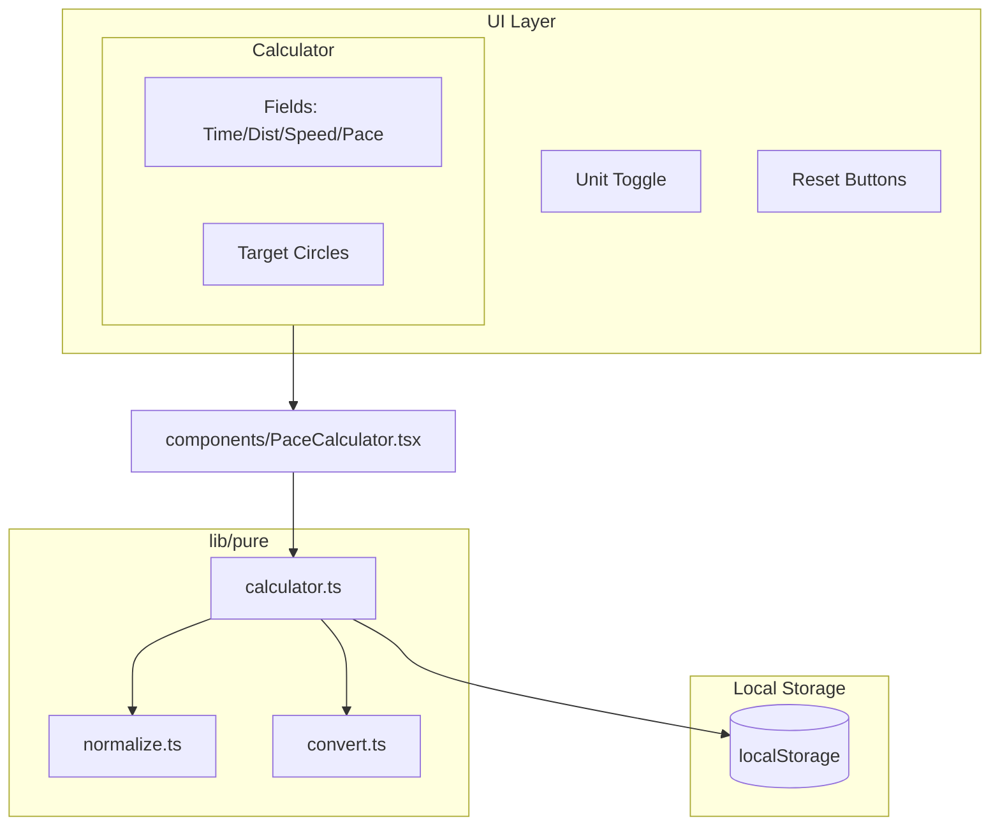

# DTS-Calc

**Distance–Time–Speed calculator for runners.** A single pace calculator: enter any two of time, distance, or speed/pace to compute the third. Metric and imperial units. Next.js (App Router) with React and TypeScript. Mobile-first layout with responsive design.

## Features

- Four linked fields: Time (HH:MM:SS), Distance (KM/MI), Speed (KM/H or MPH), Pace (MIN/KM or MIN/MI)
- Target selector: Time, Distance, or Speed. The selected target is computed from the others
- Unit toggle: Metric (km, km/h, min/km) or Imperial (mi, mph, min/mi)
- Smart input: digits auto-format to time (e.g. `123456` → `01:23:45`) or pace (e.g. `530` → `05:30`)
- LocalStorage persistence for calculator state
- Home-screen launch: JetBrains Mono is self-hosted and a service worker serves one complete shell from its cache. After one online visit, a later launch works offline. A deploy is not mixed into the open that discovers it; the second launch after the deploy runs the new shell.
- Reset: click clears values; long-press (≥500ms) factory resets
- Mobile-first frame (393×852), responsive on desktop
- Document scroll is locked. The header stays in the app column, and only an inner container scrolls, so iOS does not frost the header under the status bar
- Accessible: ARIA labels, focus-visible, high-contrast support

## Tech Stack

| Layer | Technology |
|-------|------------|
| UI | Next 16 App Router, React 19, strict TypeScript, one client component |
| Styling | `app/globals.css` (plain CSS, Tailwind loaded without its reset), self-hosted JetBrains Mono |
| Logic | `lib/pure/*`, no side effects, pinned by tests |
| Persistence | localStorage (`pace-calculator-state`), service worker (`public/sw.js`) |
| Tests | Vitest, Playwright (offline and upgrade) |
| Hosting | Vercel (Next.js) |
| Node | 24 only |

## Architecture Overview



## Directory Structure

```
DTS-Calc/
├── app/
│   ├── layout.tsx        # Metadata, viewport, link-preview tags, service worker registration
│   ├── page.tsx
│   └── globals.css       # The screen's CSS
├── components/
│   ├── PaceCalculator.tsx       # The one screen
│   └── ServiceWorkerRegister.tsx
├── hooks/
│   └── useViewportLock.ts       # Keeps the fixed app above the keyboard
├── lib/pure/
│   ├── calculator.ts     # Rules, reducer, saved-state shape
│   ├── normalize.ts, convert.ts
│   ├── linkPreview.ts    # Link-preview copy
│   ├── calculator.golden.json   # Recorded from the old plain-JS app, replayed in tests
│   └── sw*.ts, csp.ts    # Service worker rules and per-request CSP
├── public/
│   ├── sw.js             # Service worker (plain JS)
│   ├── manifest.json
│   ├── og.png            # Link-preview cover
│   └── assets/           # Icons and the self-hosted font
├── scripts/write-sw-precache.mjs   # Build step: precache list and worker build id
├── e2e/                  # Playwright: offline, upgrade (fixture: old production build)
├── proxy.ts              # CSP per request
└── vercel.json           # Next.js project; /sw.js is Cache-Control: no-cache
```

The in-app header mark is the inline 8×8 glyph in `components/PaceCalculator.tsx` (same cells as `public/assets/icon.svg`). The browser tab uses `public/assets/dts-calc-favicon.svg` (`<link rel="icon" type="image/svg+xml">`) plus `dts-calc-favicon-32.png` and `dts-calc-favicon-16.png`. The manifest does not list the favicon.

Home-screen and installed-app icons are a separate tile: the 8×8 glyph in white `#FFFFFF` on app red `#C20707`, with 2 grid squares of padding (12×12) and square corners. `public/assets/home-screen-icon.svg` is that source. `apple-touch-icon.png`, `icon-192.png`, `icon-512.png`, and `icon-maskable-512.png` are nearest-neighbour scales of the 1024×1024 master, opaque RGB with no alpha. The manifest points at those files, not the favicon.

## Routes

| Route | Purpose |
|-------|---------|
| `/` | Main calculator |

## Data Flow and Compute Model

- **Calculator**:
  - **Input**: User edits a non-target field → debounced compute (200ms)
  - **Blur**: Normalize value (time/pace auto-format from digits), then `compute()`
  - **Target**: Time, Distance, or Speed — target field is read-only; others drive it
  - **Speed vs Pace**: When both time and distance exist, speed and pace stay in sync; `lastEdited` (PACE or SPEED) decides which drives the other
- **Persistence**: `loadState()` once on load; the state is written after every action except typing (blur, compute, unit, target, clear, reset). Key `pace-calculator-state`, shape `{target, unitSystem, values:{time,distance,speed,pace}}`. On load the app also removes two keys left by the old Multi mode (`multi-pace-state`, `pace-mode`), once.

## Viewport and scrolling

iOS 26 draws a frosted scroll-edge over the header of an installed home-screen app when `html` / `body` can scroll.

`html` and `body` now fill the viewport with `overflow: hidden` and `overscroll-behavior: none` (no rubber-band). The header stays a flex row at the top of `.ctds-app`, padded by the existing safe-area inset. `.ctds-scroll` is the only scroller (`overflow-y: auto`, `overscroll-behavior: contain`). On a short or landscape screen `.ctds-scroll` moves so the fields and footer stay reachable. `viewport-fit=cover` lets the existing safe-area padding clear the status bar. `theme-color` is the solid app red and there is no status-bar meta — neither one is the frost.

When the keyboard opens, `useViewportLock` sizes the app to the visible viewport so inputs stay reachable. The document does not scroll.

## Key Concepts

- **Target field**: The computed value. Time = from distance + speed/pace; Distance = from time + speed/pace; Speed = locks both speed and pace (derived from time + distance)
- **Unit conversion**: 1 mi = 1.609344 km; applied on toggle between Metric and Imperial
- **Digits-to-time**: Raw digits (e.g. `123456`) → `01:23:45` on blur
- **Digits-to-pace**: Raw digits (e.g. `530`) → `05:30` on blur

## Getting Started

Node 24 and npm 11 are required (`nvm install`).

```bash
npm ci
npm run dev        # http://localhost:3000, service worker off
npm run build && npm run start   # production build, service worker on
```

Checks and the manual device checks are in [CONTRIBUTING.md](CONTRIBUTING.md).

## Loading

The home-screen icon opens `start_url` `/`, which is inside manifest `scope` `/`. There is no redirect. Styles are one linked CSS file (precached after the first visit), and nothing waits on `fonts.googleapis.com`. JetBrains Mono is a self-hosted latin subset with `font-display: swap`. The font file's weight axis is 400–800 and the face exposes that range. Text uses `monospace` until the file arrives, then the same family and tabular figures as before.

`public/sw.js` is registered after the page loads (production only). It is cache-first for the app shell: the HTML for `/`, the build's hashed script, style and font files, the favicon and the manifest. `npm run build` writes the list of those files and stamps a build id into the worker, so each deploy installs a new worker that downloads everything into a staging cache first and only then takes over. If that download fails, the previous shell stays. The deploy that is discovered is not mixed into the open that finds it: the second launch after a deploy runs the new shell, and the worker does not reload open pages. Navigations are served from the cache and refreshed in the background; the `/sw.js` file itself is sent with `Cache-Control: no-cache` so the browser sees a new worker.

**Upgrade from the plain-JS version.** The old worker used the caches `dts-calc-meta` and `dts-calc-<20 hex>`. The new worker deletes them once its own cache holds the full shell, and again on later starts if that was interrupted. Saved values are untouched (same key and shape). `e2e/upgrade.spec.ts` installs the old production build first, then this one, and checks all of it.

**Size.** The first load of `/` is 7 script files, 627 KB (186 KB gzip), plus 5 KB of CSS. The whole precache is 12 files, 633 KB. The plain-JS version was about 36 KB. That difference is the framework.

**Deploy.** Vercel builds with `npm run build` as a Next.js project. There is no output directory and no `/b/<hash>` rewrite any more.
