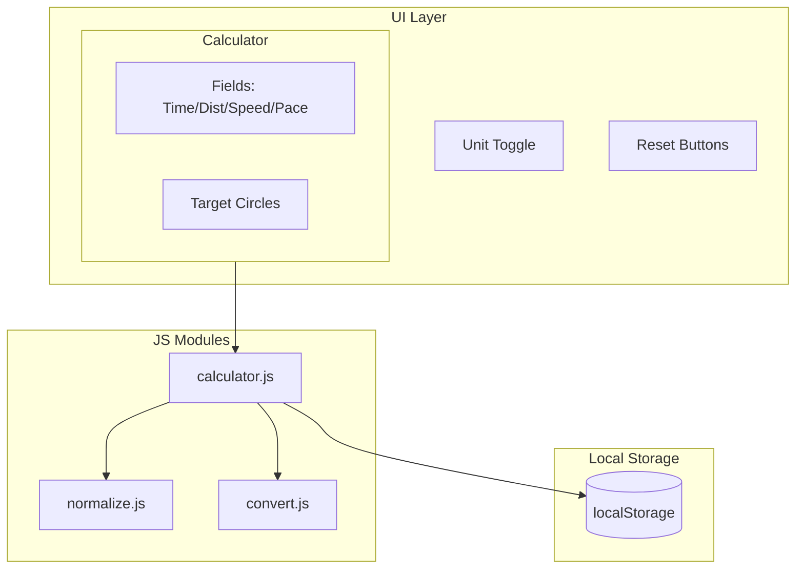

# DTS-Calc

**Distance–Time–Speed calculator for runners.** A single pace calculator: enter any two of time, distance, or speed/pace to compute the third. Metric and imperial units. Static HTML with modular ES modules. Mobile-first layout with responsive design.

## Features

- Four linked fields: Time (HH:MM:SS), Distance (KM/MI), Speed (KM/H or MPH), Pace (MIN/KM or MIN/MI)
- Target selector: Time, Distance, or Speed. The selected target is computed from the others
- Unit toggle: Metric (km, km/h, min/km) or Imperial (mi, mph, min/mi)
- Smart input: digits auto-format to time (e.g. `123456` → `01:23:45`) or pace (e.g. `530` → `05:30`)
- LocalStorage persistence for calculator state
- Home-screen launch: styles are inlined in the HTML, JetBrains Mono is self-hosted, and a cache-first service worker serves one complete shell. After one online visit, a later launch works offline. A deploy is not mixed into the open that discovers it; the second launch after the deploy runs the new shell. An already open page keeps requesting that shell's files, including after the worker process stops.
- Reset: click clears values; long-press (≥500ms) factory resets
- Mobile-first frame (393×852), responsive on desktop
- Document scroll is locked. The header stays in the app column, and only an inner container scrolls, so iOS does not frost the header under the status bar
- Accessible: ARIA labels, focus-visible, high-contrast support

## Tech Stack

| Layer | Technology |
|-------|------------|
| UI | Static HTML, vanilla JS ES modules |
| Styling | CSS inlined from `css/styles.css`, self-hosted JetBrains Mono |
| Persistence | localStorage, cache-first service worker (`sw.js`) |
| Hosting | Vercel (static) |

## Architecture Overview



## Directory Structure

```
DTS-Calc/
├── index.html       # App entrypoint (styles inlined for first paint)
├── sw.js            # Cache-first shell, one build per cache
├── css/
│   └── styles.css   # Source styles; inlined into index.html
├── js/
│   ├── calculator.js
│   ├── viewport-lock.js       # Keeps the fixed app above the keyboard
│   ├── normalize.js
│   └── convert.js
├── assets/
│   ├── icon.svg               # 8×8 header glyph (transparent, black pixels)
│   ├── dts-calc-favicon.svg   # Browser-tab icon (10×10, white on #C20707)
│   ├── dts-calc-favicon-32.png
│   ├── dts-calc-favicon-16.png
│   ├── home-screen-icon.svg   # Home-screen source: 8×8 glyph, 2-cell padding (12×12)
│   ├── apple-touch-icon.png   # 180×180 home-screen icon
│   ├── icon-192.png           # 192×192 installed-app icon
│   ├── icon-512.png           # 512×512 installed-app icon
│   └── icon-maskable-512.png  # 512×512 maskable icon (same tile; padding covers the safe zone)
├── assets/fonts/
│   ├── jetbrains-mono-latin.woff2  # Latin variable font, axis 400–800
│   └── OFL.txt
├── manifest.json    # App name and home-screen / installed-app icon set
├── vercel.json      # Rewrite `/` → index.html; `sw.js` is `Cache-Control: no-cache`
└── README.md
```

The in-app header mark is the inline 8×8 glyph in `index.html` (same cells as `assets/icon.svg`). The browser tab uses `assets/dts-calc-favicon.svg` (`<link rel="icon" type="image/svg+xml">`) plus `dts-calc-favicon-32.png` and `dts-calc-favicon-16.png`. The manifest does not list the favicon.

Home-screen and installed-app icons are a separate tile: the 8×8 glyph in white `#FFFFFF` on app red `#C20707`, with 2 grid squares of padding (12×12) and square corners. `assets/home-screen-icon.svg` is that source. `apple-touch-icon.png`, `icon-192.png`, `icon-512.png`, and `icon-maskable-512.png` are nearest-neighbour scales of the 1024×1024 master, opaque RGB with no alpha. The manifest points at those files, not the favicon.

## Routes

| Route | Purpose |
|-------|---------|
| `/` | Main calculator (rewrites to `index.html`) |

## Data Flow and Compute Model

- **Calculator**:
  - **Input**: User edits a non-target field → debounced `compute()` (200ms)
  - **Blur**: Normalize value (time/pace auto-format from digits), then `compute()`
  - **Target**: Time, Distance, or Speed — target field is read-only; others drive it
  - **Speed vs Pace**: When both time and distance exist, speed and pace stay in sync; `lastEdited` (PACE or SPEED) decides which drives the other
- **Persistence**: `saveState()` / `loadState()` applied on init, compute, clear, and reset events. On load the app also removes two keys left by the old Multi mode, once.

## Viewport and scrolling

iOS 26 draws a frosted scroll-edge over the header of an installed home-screen app when `html` / `body` can scroll.

`html` and `body` now fill the viewport with `overflow: hidden` and `overscroll-behavior: none` (no rubber-band). The header stays a flex row at the top of `.ctds-app`, padded by the existing safe-area inset. `.ctds-scroll` is the only scroller (`overflow-y: auto`, `overscroll-behavior: contain`). On a short or landscape screen `.ctds-scroll` moves so the fields and footer stay reachable. `viewport-fit=cover` lets the existing safe-area padding clear the status bar. `theme-color` is the solid app red and there is no status-bar meta — neither one is the frost.

When the keyboard opens, `viewport-lock.js` sizes the app to the visible viewport so inputs stay reachable. The document does not scroll.

## Key Concepts

- **Target field**: The computed value. Time = from distance + speed/pace; Distance = from time + speed/pace; Speed = locks both speed and pace (derived from time + distance)
- **Unit conversion**: 1 mi = 1.609344 km; applied on toggle between Metric and Imperial
- **Digits-to-time**: Raw digits (e.g. `123456`) → `01:23:45` on blur
- **Digits-to-pace**: Raw digits (e.g. `530`) → `05:30` on blur

## Getting Started

**Prerequisites:** None to read the page. The service worker needs an http origin, so use a local server rather than opening the file directly.

For regression tests and manual verification, see [CONTRIBUTING.md](CONTRIBUTING.md).

```bash
python3 -m http.server 8000
# Visit http://localhost:8000/
```

After editing `css/styles.css` or any other shell file, run `npm run build`. That inlines the stylesheet, stamps the service worker's build hash, and copies the shell into `dist/`. Running it again on an up-to-date tree does not edit committed files. The build uses only Node's own modules, so it does not need the test dependencies. Vercel runs the same command and publishes `dist/` (`framework` is null, `outputDirectory` is `dist`). CI fails if the build would edit a committed file.

## Loading

The home-screen icon opens `start_url` `/`, which is inside manifest `scope` `/`. There is no redirect. `index.html` contains the full stylesheet, so the first paint does not wait on a second CSS request or on `fonts.googleapis.com`. JetBrains Mono is a self-hosted latin subset with `font-display: swap` (the face is discovered in that first HTML response, so it is not preloaded). The font file's weight axis is 400–800 and the face exposes that range. Text uses `monospace` until the file arrives, then the same family and tabular figures as before.

`sw.js` is registered from the `load` event. It is cache-first for one whole shell (HTML, JS, font, icons). The build hash in the cache name is the hash of those files, stamped by `npm run build`, so a deploy installs a new worker that precaches the full list. Cached HTML points its scripts and font at `/b/<hash>/...`. Icons and the manifest stay on stable URLs such as `/assets/apple-touch-icon.png` and `/manifest.json`, so a home-screen fetch that does not go through the worker still finds them. `vercel.json` rewrites `/b/<hash>/...` to the same file in `dist/`. A later script request is served from that build's cache, including after the worker process has stopped. If that older cache has been evicted, the request falls through to the current file until the next navigation. A navigation also refetches the whole list with `cache: 'no-cache'` into a new cache and publishes it only when every file is stored. If the current build cache is missing while its meta entry remains, that launch reads the shell from the network and stores the cache again. The open that discovers the deploy keeps the previous shell. The second launch after the deploy runs the new shell. Activate deletes caches from other builds once no open page still needs them; which page needs which build is stored in the cache, not only in the worker process. The worker does not reload open pages. `css/styles.css` is not requested at runtime, so it is not part of the shell. `vercel.json` sends `Cache-Control: no-cache` for `/sw.js` so the browser can detect a new worker script.

**Deploy to Vercel:**

```bash
vercel
```

`vercel.json` rewrites `/` to `/index.html`, and `/b/<hash>/<path>` to `/<path>`. Those routes apply to the published `dist/` files, including `/sw.js`.
